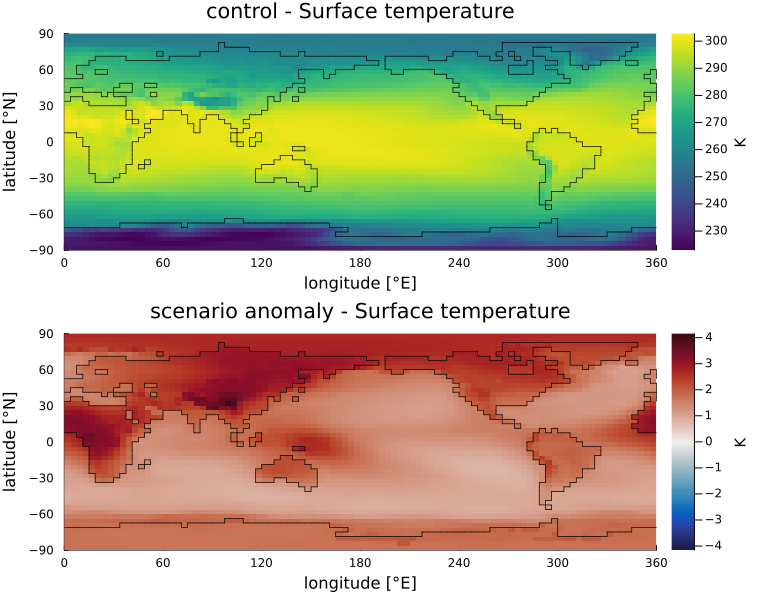
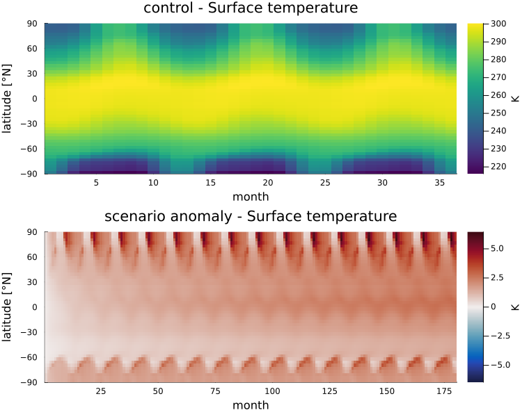
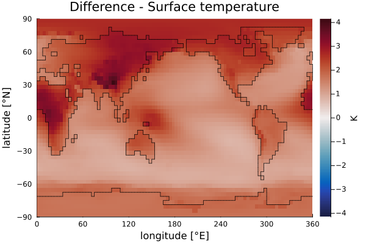

# The plots

Every plot takes a `greb_model!` result, drawing control and scenario as
separate panels, or a plain vector of monthly records. Each returns a `Plots.Plot`:
show it, or save it with `savefig`.

## For one run

| Function | Shows | How to read it |
|:---------|:------|:---------------|
| `plot_map` | One variable over the globe, averaged over the run (`month = :mean`), in the last month (`:last`) or in month `n` | *Where* a quantity is high or low, or, for the scenario, where it changed most |
| `plot_timeseries` | The global mean per month, or per year with `annual = true`; `mask` restricts it to a region | *How fast* the climate changes, and whether it has settled |
| `plot_seasonal` | The average of each calendar month over the whole years in the run | The seasonal cycle, and for the scenario which seasons changed most |
| `plot_zonal` | The mean over longitude against latitude | The latitude profile, e.g. polar amplification |
| `plot_hovmoller` | The mean over longitude, as a colour against month (x) and latitude (y) | How a signal moves between latitudes and seasons, e.g. polar warming that peaks in one season each year |
| `evolution` + `evolution_frame` / `evolution_gif` | The map month by month (or year by year) on a fixed colour scale | The map changing through the run; same colour means same value in every frame |

```julia
plot_map(result; var = :Ts, fields = fields)
plot_timeseries(result; annual = true)
plot_timeseries(result; annual = true, mask = band_mask(fields.z_topo; south = 66.5))  # Arctic
plot_seasonal(result; var = :precip)
plot_zonal(result)
plot_hovmoller(result)

ev = evolution(result; var = :Ts, step = :year)
evolution_frame(ev, 3; fields = fields)
evolution_gif("run.gif", ev; fields = fields)
```

Figures: a 2xCO2 run of 15 years after a 3-year control. `plot_map` shows the control and the scenario (the change against the control):



`plot_hovmoller`: the warming at the poles repeats with the seasons, and the tropics warm evenly.



## For several runs

| Function | Shows | How to read it |
|:---------|:------|:---------------|
| `plot_difference(a, b)` | `a - b` of two record vectors as a map, on a scale centred at zero | *Where* one run differs from the other |
| `plot_compare(members)` | The global mean of several runs as lines on one set of axes | Which run warms faster or settles higher |
| `plot_members(members)` | One bar per ensemble member | The size of each member's effect, with `baseline` as a difference to one of them |

A scenario that is an anomaly has to be made absolute before it is differenced against its control:

```julia
plot_difference(to_absolute(result.scnr, result.ctrl), result.ctrl; fields = fields)   # where the doubled CO2 acts
plot_difference(a.scnr, b.scnr; fields = fields)                                     # two scenarios of one preset

plot_compare(["full model" => full, "no ice albedo" => no_ice])   # greb_model! results
plot_members(["full model" => 2.76, "no ice albedo" => 2.52]; xlabel = "warming [K]", baseline = "full model")
```

`plot_difference` of the scenario against the control shows where the doubled CO2 acts:



`plot_members` takes plain numbers, for example the values a `run_ensemble` reducer returns
(see `examples/feedback_deconstruction.jl`).

Given a `greb_model!` result, the plots read the year and month of each record
from its `ctrl_time` and `scnr_time`, so an animation frame is titled
`Jul 1950`. A bare record vector carries no times and is counted from January
of year 1.
